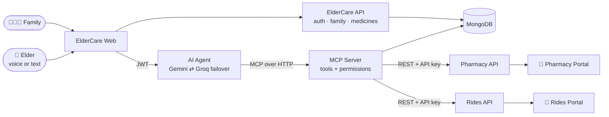

<div align="center">

# 💙 ElderCare

### Just say it. The medicine gets ordered, the cab gets booked, the family gets told.

A voice-first care companion that helps older adults handle everyday tasks by talking, while their family stays in the loop.

[Demo video](#-demo) · [Features](#-features) · [How it works](#-how-it-works) · [Run it locally](#-run-it-locally)

</div>

---

## 🎬 Demo

<div align="center">

<video src="https://github.com/Rakshita006/ElderCare/raw/main/docs/elder-care-demo.mp4" controls muted width="100%"></video>

[▶️ Can't see the player? Watch the demo video here](https://drive.google.com/file/d/1U-EmwAJpsmBILupdzxGmAyEdfPhTDz1d/view)

</div>

| Try it live         | Link                                                                      |
| ------------------- | ------------------------------------------------------------------------- |
| **ElderCare app**   | [elder-care-web-bice.vercel.app](https://elder-care-web-bice.vercel.app/) |
| **Pharmacy portal** | [elder-care-pharmacy.vercel.app](https://elder-care-pharmacy.vercel.app/) |
| **Rides portal**    | [elder-care-web-uq73.vercel.app](https://elder-care-web-uq73.vercel.app/) |

---

## 🧓 The problem

Phones are built for people who are comfortable tapping through menus. For many older adults, reordering a tablet or booking a cab to the clinic means juggling several apps, and for their children it means worrying from far away, or making the call on their behalf.

## 💡 Our solution

**ElderCare** lets an older adult simply talk (or type) to an assistant: _"Order Mom's sugar medicine"_, _"Book a cab to the clinic"_. The assistant works out what is meant, **reads the details back for confirmation**, and then does the real thing: it places the order with a pharmacy and books the ride with a dispatcher. Family members are notified, and can help out, within the permissions the elder has given them.

It is not a chatbot that pretends. The medicine order lands in a real pharmacy portal, the ride lands in a real dispatch queue, and the statuses you see are the statuses those systems report.

---

## ✨ Features

### 🗣️ Voice-first AI care assistant

- Talk to the assistant by voice, or type. Speech input and spoken replies in **English and Hindi**.
- Understands everyday phrasing, including family words: _"mom"_, _"uncle"_, or the private nickname you gave someone.
- If a name matches more than one person, it **asks** instead of guessing.
- Friendly, plain-language tone, with clear states for listening, thinking and done.

### 💊 Medicines and dose tracking

- Keep each person's medicines in one place: strength, schedule, pack size and remaining supply.
- Log doses with one tap (**"Mark taken"**), with undo. The remaining count only changes when a dose is actually logged.
- Know roughly how many days are left, and reorder when supply runs low.
- Adding a known brand auto-fills its details from the pharmacy catalogue.

### 🛒 Medicine ordering with a real pharmacy

- Search the pharmacy catalogue and order by voice or from the app.
- **Two-step ordering:** the assistant prepares a draft, reads it back, and only places _exactly that draft_ after you confirm. A repeated confirmation never creates a duplicate order.
- Cash on delivery. Delivered orders automatically top up the medicine supply, once.

### 🚕 Cab booking with a real dispatcher

- _"Book a cab to the clinic"_: pickup defaults to the saved home address, and the assistant confirms the details and the fare estimate before booking.
- Same safe two-step flow as ordering: draft, read back, then book. Repeat confirmations are idempotent.
- Track status on demand, and cancel any time before the ride starts.

### 👨‍👩‍👧 Family circle and notifications

- A family is a real group: invite members with single-use invite codes, and every relationship (son, niece, uncle…) is **derived automatically** from the first connection.
- **Granular permissions per person:** who can manage medicines and orders, who can book rides, who gets notified, and who is an admin.
- Private aliases: call your daughter "Beta" and the assistant understands.
- The family is notified when an order is placed or a ride is booked, and again when a ride completes, is cancelled or is rejected.
- Access is enforced on the server for every action, not only in the UI.

### ♿ Built for older adults

- Large, high-contrast, touch-friendly UI with a one-switch **large text** mode.
- Voice, text, and plain buttons all work. Nothing _requires_ the assistant.
- India-first: 10-digit phone numbers, OTP login, rupee pricing, IST-aware ride times.

### 🏪 Pharmacy portal (independent app)

- Pharmacists get their own web app: an **overview** with orders by status, needs-action items and stock alerts, plus **orders** and **catalogue / stock** management.
- Orders move through `placed → accepted → packed → out for delivery → delivered` (or rejected / cancelled).
- Stock is reserved atomically when an order is placed, and the portal updates as new orders arrive.

### 🚗 Rides portal (independent app)

- Dispatchers get a **dispatch queue**, a **driver availability** view and driver management.
- Rides move through `requested → accepted → arriving → in progress → completed` (or rejected / cancelled before the ride starts).
- The dispatcher assigns a driver when accepting a ride. Fare is base + per-km when both places have coordinates, otherwise a flat estimate.

---

## 🧠 How it works



**One request, end to end**

1. The elder says _"Order Mom's sugar medicine."_ The browser transcribes it and sends it to the agent with the user's login token.
2. The agent (an LLM) decides which **MCP tools** to call. It has **no hardcoded tools**, and the user's identity is injected from the verified token, never taken from the model or the request body.
3. The MCP server resolves _"Mom"_ (alias, then relationship, then name), checks the caller's permissions, and calls `prepare_order`, which stores a 15-minute draft.
4. The assistant **reads the draft back**. When the user says yes, `place_order` places exactly that draft with the pharmacy.
5. The pharmacist sees the order in the Pharmacy portal and moves it along. The family is notified, and the medicine supply is topped up on delivery.

**Design choices we're proud of**

- **Safe by construction:** every consequential action (ordering, booking) is a two-step draft → confirm, with idempotency so a double "yes" can't double-order.
- **Permissions enforced at the tool layer**, so the assistant can only do what the signed-in person is allowed to do for that elder.
- **Provider-neutral, resilient AI:** LLMs are tried in order (Gemini, then Groq). On any error (rate limit, bad key, outage) the agent switches to the next immediately and skips the failed one for a cooldown, even mid-conversation.
- **Genuinely independent partner apps:** the pharmacy and rides services have their own databases and API-key auth, and know nothing about ElderCare. ElderCare talks to them like any partner would.
- **No fake data:** statuses shown are only those reported by the real services or recorded user actions.

---

## 🧰 Tech stack

| Layer     | Tech                                                                              |
| --------- | --------------------------------------------------------------------------------- |
| Frontends | React 18, Vite, TypeScript, react-router (ElderCare, Pharmacy and Rides web apps) |
| Services  | Node.js, Express, TypeScript (API, Agent, MCP, Pharmacy API, Rides API)           |
| AI        | Model Context Protocol (MCP), Google Gemini, Groq, provider-neutral agent loop    |
| Data      | MongoDB (separate databases for ElderCare, pharmacy and rides)                    |
| Auth      | Phone + OTP, JWT, API keys for partner systems                                    |
| Voice     | Web Speech API for speech recognition and synthesis (English / Hindi)             |
| Monorepo  | pnpm workspaces, shared TypeScript types package                                  |

## 🗂️ Project layout

```
apps/
  elder-care-web/   The elder + family app (assistant, medicines, family, profile)
  pharmacy-web/     Pharmacist portal
  rides-web/        Dispatcher portal
services/
  api/              Auth, users, family, medicines, orders
  agent/            LLM agent loop with provider failover (port 3002)
  mcp/              MCP server: tools, resolver, permissions (port 3003)
  pharmacy-api/     Independent pharmacy service
  rides-api/        Independent rides service
packages/shared/    Types and helpers shared across services and the web app
bruno/              API collections for manual testing
```

---

## 🚀 Run it locally

**Prerequisites:** Node.js ≥ 20, pnpm ≥ 9, a MongoDB instance, and at least one LLM key (Gemini or Groq).

```bash
pnpm install
pnpm --filter @eldercare/shared build

# copy each service's .env.example to .env and fill in the values
# (MongoDB URI, JWT secret, LLM key, pharmacy / rides API keys)

pnpm --filter @eldercare/pharmacy-api seed   # sample medicines + pharmacist login
pnpm --filter @eldercare/rides-api seed      # sample drivers + dispatcher login

pnpm dev                                     # starts every app and service
```

| App             | URL                   |
| --------------- | --------------------- |
| ElderCare web   | http://localhost:5173 |
| Pharmacy portal | http://localhost:5174 |
| Rides portal    | http://localhost:5175 |

> Set `OTP_DEV_MODE=true` in the API's `.env` to see the login OTP in the response while testing.

---

## 🛣️ What's next

- Real-time push notifications for the family (live updates instead of on-demand refresh)

---

<div align="center">

_Built with care, for the people who cared for us._ 💙

</div>
